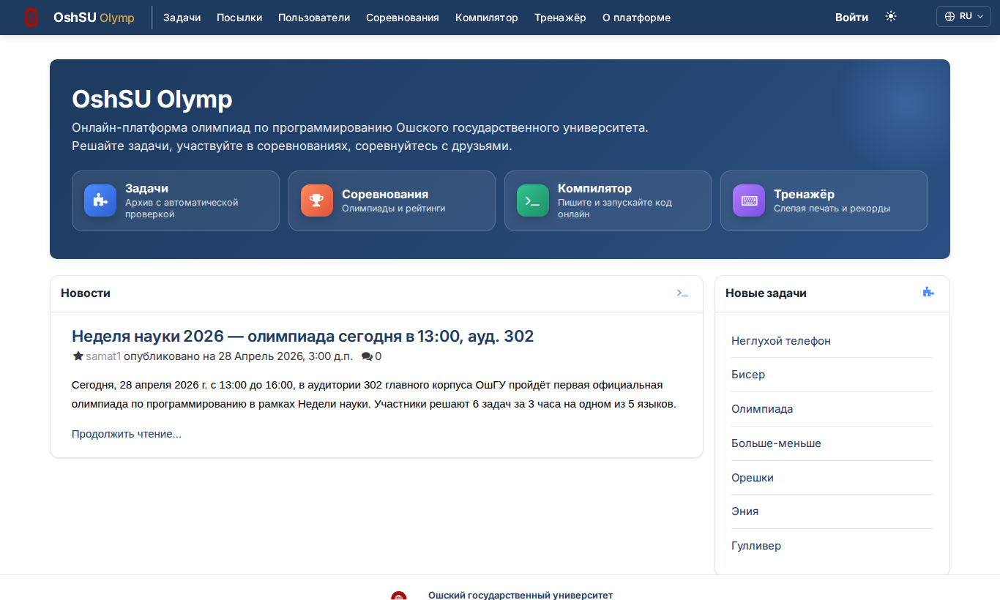
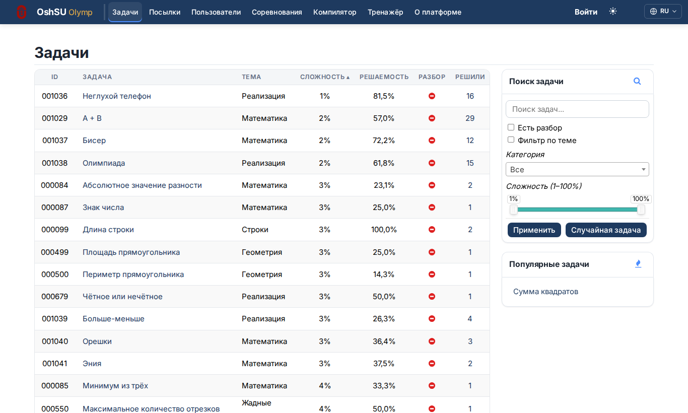
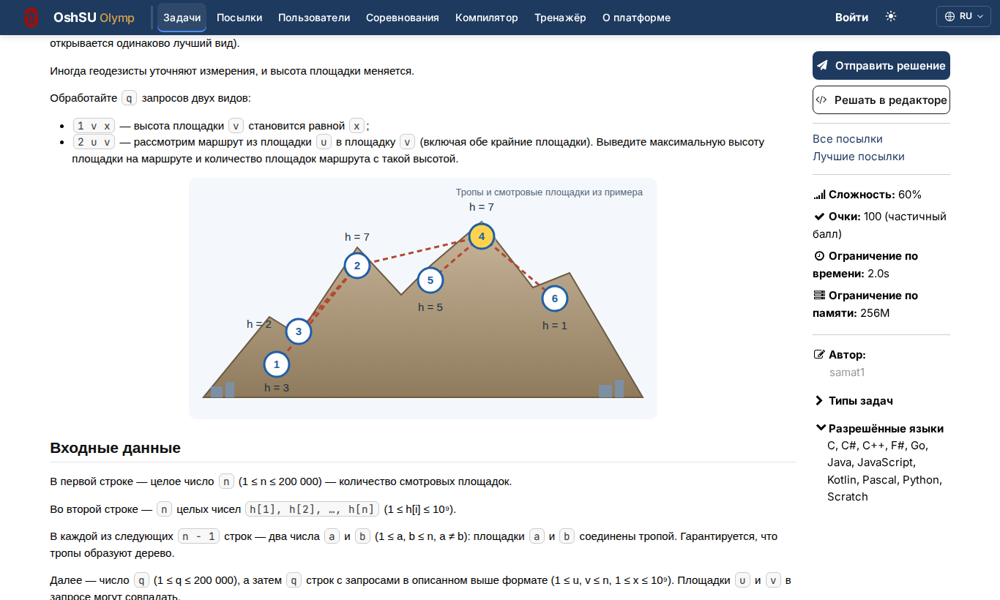
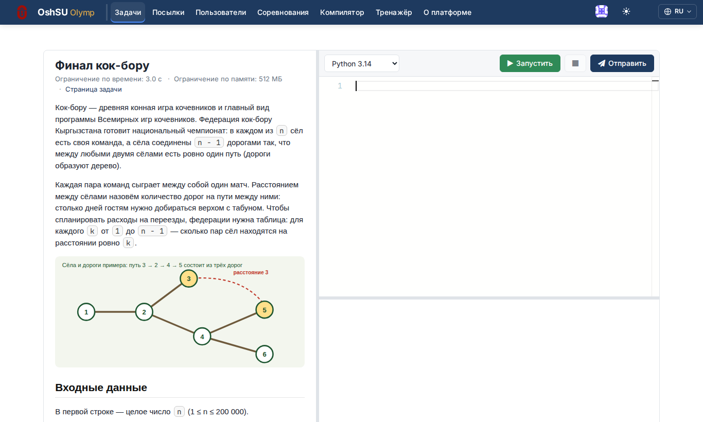
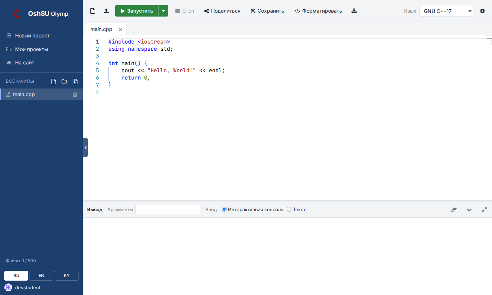
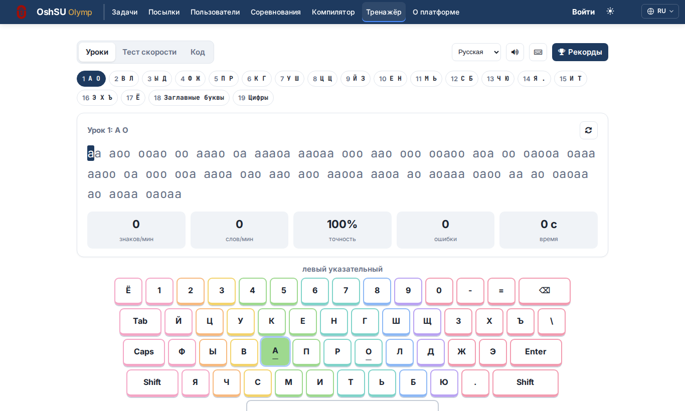
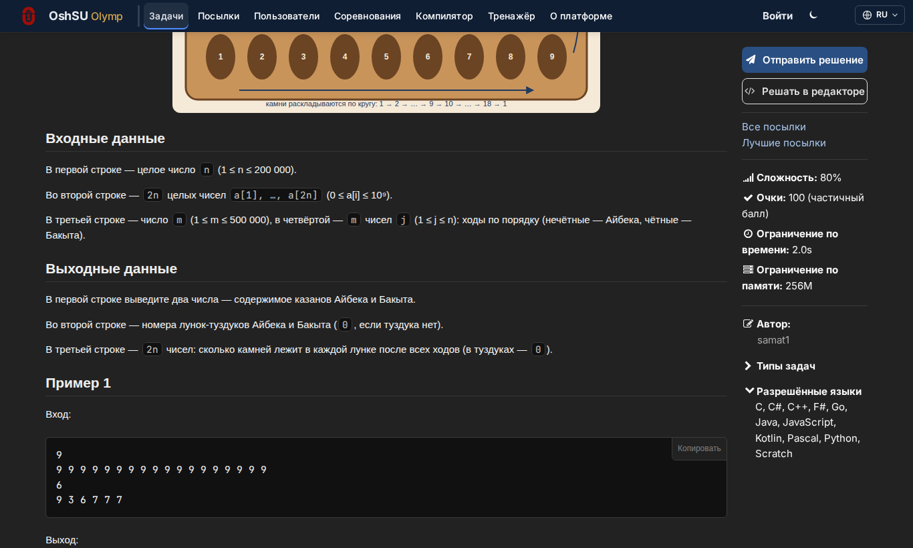

# OshSU Olymp

Онлайн-платформа для проведения олимпиад и тренировочных соревнований по программированию. Разработана в Ошском государственном университете (ОшГУ) на базе кафедры информационных систем и программирования (ИСП) МФТИТ.

Платформа построена на движке **[DMOJ](https://github.com/DMOJ/site)** (open source). Ребрендинг, дополнительная функциональность, локализация на три языка (ru/en/ky) — OshSU Olymp.



## Возможности

- **Автоматическая проверка решений** на C, C++ (14/17/20), Java, Python 3.14, C# и F# (.NET 10), Go, Kotlin, JavaScript (Node.js), Pascal и Scratch 3.
- **Олимпиады** в форматах IOI (частичные баллы, подзадачи) и ICPC/AtCoder (штраф за попытки), живое табло, продление на 15 минут, итоги в Excel, рейтинг по университетам.
- **Защита от списывания:** контроль переключения вкладок и вставки чужого кода, предупреждения и журнал нарушений для жюри.
- **Редактор прямо на странице задачи** (Monaco): запуск, проверка на примерах, отправка.
- **Компилятор** `/compiler/` — онлайн-среда как onlinegdb: проекты, вкладки и файлы, терминал с вводом, аргументы, форматирование, ссылки на код.
- **Тренажёр слепой печати** `/typing/`: уроки на русском, кыргызском и английском, тест скорости, набор кода, рекорды.
- **Архив задач** с темами, сложностью от 1 до 100% и поиском; задачи олимпиады после её окончания автоматически попадают в архив.
- **Импорт задач** из файла условия и архива тестов в админке; команда `import_problemset` добавляет готовые наборы задач, ничего не меняя на сайте.
- **17 авторских задач о Кыргызстане** высокой сложности с подзадачами, схемами и проверенными тестами (`problemsets/kg2026`).
- Массовая генерация учётных записей участников, тёмная тема, три языка интерфейса (русский, кыргызский, английский), мобильная вёрстка.

## Скриншоты

| | |
|---|---|
|  |  |
|  |  |
|  |  |

## Документация

- [docs/DEPLOY-2026-10.md](docs/DEPLOY-2026-10.md) — выкат обновления на сервер сайта и сервер проверки.
- [docs/LOAD-1000.md](docs/LOAD-1000.md) — олимпиада на 1000 участников: нагрузка и настройки серверов.
- [DEVOPS.md](DEVOPS.md) — установка платформы с нуля.
- [scripts/dev/README.md](scripts/dev/README.md) — локальная копия сайта в WSL и проверки перед выкатом.
- [scripts/judge/README.md](scripts/judge/README.md) — языки на сервере проверки.
- [problemsets/kg2026/README.md](problemsets/kg2026/README.md) — задачи о Кыргызстане: сборка тестов и загрузка.

## Стек

- **Backend:** Django 4.2 + Python 3.12
- **DB:** PostgreSQL 16+
- **Cache + Celery broker:** Redis (prod)
- **Бридж судей:** TCP-сокеты (`judge/bridge/`)
- **Event-daemon:** Node.js websocket server (`websocket/daemon.js`)
- **Судья:** [DMOJ judge-server](https://github.com/DMOJ/judge-server) — отдельный процесс (Linux/WSL)
- **Frontend:** Jinja2 + SCSS → CSS (via `sass` + `postcss` + `autoprefixer`)

## Быстрый старт (dev)

```bash
# 1. Python окружение
python3.12 -m venv venv
venv\Scripts\activate  # Windows
# source venv/bin/activate  # Linux/macOS
pip install -r requirements.txt

# 2. Локальные настройки
cp dmoj/prod_settings.py.example dmoj/local_settings.py
# Отредактируй local_settings.py (SECRET_KEY, DB и др.).
# PostgreSQL обязателен — создайте БД olymp_oshsu.

# 3. База
python manage.py migrate
python manage.py loaddata navbar language_small

# 4. Суперпользователь
python manage.py createsuperuser

# 5. Статика
sh make_style.sh          # нужны sass, postcss-cli, autoprefixer глобально (npm i -g)
python manage.py collectstatic --noinput
python manage.py compilejsi18n

# 6. Переводы .po → .mo (без GNU gettext)
pip install Babel
python -c "from babel.messages.mofile import write_mo; from babel.messages.pofile import read_po; import os
for lang in ('ru','en','ky'):
    for po in ('django.po','djangojs.po','dmoj-user.po'):
        p = f'locale/{lang}/LC_MESSAGES/{po}'
        if os.path.isfile(p):
            with open(p,'rb') as f: c = read_po(f)
            with open(p[:-3]+'.mo','wb') as f: write_mo(f, c)"

# 7. Запуск (3 процесса)
python manage.py runbridged                   # окно 1 — bridge судей
python manage.py runserver 127.0.0.1:8000     # окно 2 — web
cd websocket && npm install ws simplesets qu  # разовая установка
node websocket/daemon.js                      # окно 3 — event daemon
```

## Судья (отдельная машина, Linux)

Для C# на Microsoft .NET установите дополнительный модуль судьи по
[инструкции](scripts/judge/README.md). Одной настройки языка на сайте недостаточно.

```bash
git clone --recursive https://github.com/DMOJ/judge-server.git
cd judge-server
python3 -m venv venv && source venv/bin/activate
pip install -e .

# Настройте ~/judge-config/judge.yml
# Запуск:
dmoj -c ~/judge-config/judge.yml -p 9999 --skip-self-test <BRIDGE_HOST>
```

## Админ-гайд

Для преподавателей/админов — пошаговая инструкция как провести олимпиаду: https://olymp.oshsu.kg/admin-guide/

В настройках расписания олимпиады «Публиковать задачи после олимпиады» включено
по умолчанию. После `end_time` задачи становятся публичными, общедоступными
и видимыми в архиве. Скрытые черновики не публикуются. Закрытая для участников
олимпиада также отдаёт задачи в общий архив после завершения. Задача, используемая
в другой опубликованной незавершённой олимпиаде, ждёт окончания обеих.
Публикация выполняется один раз; добавленные позднее задачи обрабатываются снова.

На сервере после миграций установить проверку раз в минуту:

```bash
sh scripts/deploy_contest_publication.sh
```

Состояние: `systemctl status olymp-publish-problems.timer`.
Ручной запуск той же проверки: `venv/bin/python manage.py publish_contest_problems`.

## Полезные URL

- `/<ADMIN_URL>/` — админка
- `/<ADMIN_URL>/generate-users/` — массовая генерация учёток участников
- `/admin-guide/` — гайд для админов
- `/status/` — статус судей (не в меню, только по прямой ссылке)
- `/contest/<key>/` — страница соревнования
- `/contest/<key>/ranking/` — табло
- `/problems/` — архив задач
- `/problem/<code>/submit` — отправить решение

## Основа и лицензия

OshSU Olymp построен на открытом движке **[DMOJ](https://github.com/DMOJ/site)** (© авторы DMOJ, лицензия [AGPL-3.0](LICENSE)). Проверка решений работает на [DMOJ judge-server](https://github.com/DMOJ/judge-server). Компилятор, тренажёр слепой печати, защита от списывания, редактор на странице задачи, новый интерфейс, локализация и задачи — собственная разработка ОшГУ.

Весь код, включая наши изменения, распространяется под той же лицензией AGPL-3.0: исходный код открыт в этом репозитории, а сайт olymp.oshsu.kg работает на нём.

## Контакты

- Руководитель: **Карабаев С. Э.**, кафедра ИСП МФТИТ ОшГУ
- Email: <skarabaev@oshsu.kg>
- Сайт университета: [oshsu.kg](https://oshsu.kg)
